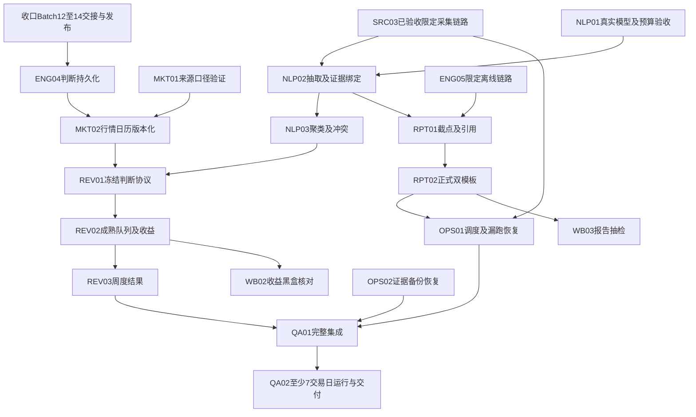

# 全球市场信息 Agent：完整开发与任务流计划

版本：2026-11-17 / Batch14后综合版。状态来源：collaboration/task-board.json；最新实现与验收：docs/verification/batch-14.md。本文为综合计划，不修改任务状态、不替代验收记录；“建议调整”尚未写入权威依赖。

## 1. 项目目标与交付边界

面向单个A股研究者，自动采集已验证的国内/海外官方信息，保存证据版本，生成可追溯的盘前/盘后简报，减少阅读整理时间。全球描述信息视角，不承诺全市场或全网覆盖。

交付分为事件简报软件与判断效果评价两条线。技术可运行、用户价值、研究有效性分别给结论。首版不增加自主多Agent产品调度框架；开发阶段采用多Agent，运行采用确定性流水线。正文/fixture/外部凭证均是数据，不能授予权限。

当前真实来源范围是Fed RSS、国家统计局可见列表的标题/日期/链接元数据；此前共验证35条归档事件（Fed20、NBS15），不是2026-11-17新抓取结果。正文留存许可与语义事实抽取尚未通过，不能用标题支持正文事实。

## 2. 当前真实进度

26主任务：9已完成、3进行中、13待开发、1取消；不按数量估算工时完成比例。Batch子工作包不重复计入26项。

已具备：环境和普通安装、公共证据契约、元数据采集/去重/检查点/持久队列、不可变证据库schema4、固定输入版本报告及离线重放、一致备份/副本恢复；模型账本schema3、预算预留/重试/缓存、DeepSeek受限传输适配、账本身份绑定、只读声明核对和恢复预检、成功/失败响应哈希关联；候选固定快照与自包含重放；Batch12供应商证据缺口预检、Batch13环境恢复、Batch14未认证凭证声明比对。

最近全套离线验收：526运行523通过3符号链接权限跳过，52.303秒exit0；独立32定向+4自构造场景全通过，覆盖重叠不相加。Batch13普通隔离安装及当时518项全套通过；Batch14新增模块未重新普通安装。

尚无真实付费模型/逐调用账单验证、生产结算/恢复切换、正式语义简报、行情评价或7交易日运行验收。用户最新选择“先完成离线准备”。10元限制为UTC日单账本配置费率估算，并非供应商账户全局硬限额。

发布：此前Batch11已核验GitHub发布，Batch12/13/14本地变更尚未提交上传。发布前按本轮来源清单核对，排除凭证/运行库/备份/venv/对话ZIP及无关output/tmp；不得全目录盲目提交。

## 3. 完整WBS与权威依赖

| ID | 工作内容 | 当前状态 | 权威前置 | 完成条件 |
|---|---|---|---|---|
| ENG-01 | 定位并验证Python、SQLite与时区环境 | 已完成（限定验收范围） | 无 | 记录实际Python执行路径及版本，不能仅依据py启动器判断；执行sqlite3与zoneinfo检查并保存命令和结果；无可用解释器时记录阻塞，不声称测试通过 |
| ENG-02 | 建立可安装项目脚手架和Git基线 | 已完成（限定验收范围） | ENG-01 | 新隔离环境按文档安装并运行CLI help；密钥与运行数据不纳入版本库；保存公共开发基线并保留已有文件 |
| ENG-03 | 冻结公共契约与样例v0 | 已完成（限定验收范围） | ENG-02 | 定义ID、UTC、证据、事件、判断、错误及状态语义；有效与无效输入测试通过；实现者确认接口与版本，禁止猜测共享字段 |
| ENG-04 | 实现存储、迁移与不可变保护 | 进行中 | ENG-03 | 外键与唯一键检查通过；历史判断普通修改被拒绝，更正使用追加；副本迁移、事务回滚及引用完整性通过 |
| ENG-05 | 打通离线证据到简报的最小链路 | 已完成（限定验收范围） | ENG-04 | 单命令离线生成带引用报告；固定输入重跑无重复记录；记录输入清单及未启用的真实功能 |
| SRC-01 | 验证首批真实新闻来源 | 已完成（限定验收范围） | ENG-03 | 候选逐项记录真实请求与解析字段；验证时间、正文、增量能力及内容保留条件；明确通过、不通过和待确认，不用候选数量冒充覆盖 |
| SRC-02 | 实现RSS及首个页面或API适配器 | 已完成（限定验收范围） | SRC-01、ENG-05 | 真实样本离线解析通过；覆盖空页、编码、缺失正文及异常格式；联网探测结果与日常离线测试分开记录 |
| SRC-03 | 实现增量、幂等与失败恢复 | 已完成（限定验收范围） | SRC-02 | 失败不推进检查点；重跑无重复，乱序及同时间戳不漏项；正文修订保留新版本，单源故障可隔离 |
| MKT-01 | 验证标的、基准、行情与交易会话来源 | 进行中 | ENG-03 | 代码、币种、OHLC和调整口径可解释；日历来源及可回溯范围有证据；不合格来源对应协议保持关闭 |
| MKT-02 | 实现行情与日历的版本化同步 | 待开发 | MKT-01、ENG-04 | 假期、DST与提前收市测试通过；缺失、异常价格与公司行动触发明确状态；修订新增版本，旧快照仍可查询 |
| NLP-01 | 实现模型客户端、预算与缓存 | 进行中 | ENG-03 | 超时、错误JSON、重试及超额mock测试通过；真实调用前明确限额与凭证配置；缓存键包含输入内容、provider/model、完整提示词、提示词/规则/输出模式及schema版本、schema内容、参数和输出限制；核对缓存归属及输出hash |
| NLP-02 | 实现抽取分类与证据绑定 | 待开发 | NLP-01、SRC-03 | 缺失信息保留空值而非补造；每个事实绑定有效证据片段；验证集独立，来源正文指令不能改变系统行为 |
| NLP-03 | 实现规则聚类、歧义裁决与冲突保留 | 待开发 | NLP-02 | 精确去重先由代码处理；误合并与漏合并分别报告；后续进展与矛盾证据不覆盖历史 |
| RPT-01 | 实现报告截点与引用检查 | 待开发 | NLP-02、ENG-05 | 截点后的首次观察数据不进入截点版；无效引用拒绝发布；事实、解释及观察事项明确区分，无主题不强填 |
| RPT-02 | 实现双模板、降级与原子归档 | 待开发 | RPT-01 | HTML与Markdown包含截点、行情时点、run_id与状态；模型或行情缺失时生成明确降级版；发布失败不覆盖旧版，补版有独立版本 |
| REV-01 | 冻结判断与评价协议 | 待开发 | MKT-02、NLP-03 | 固定方向语义、标的、基准、阈值和时间窗口；价格起点严格晚于校验提交成功的committed_at；缺字段拒收，历史更正追加 |
| REV-02 | 实现成熟队列与AR/CAR核对 | 待开发 | REV-01 | 手算价格样例一致；未成熟不评分，缺失不当作零收益；同快照、协议与算法版本重算数值一致 |
| REV-03 | 实现周度样本与结果报告 | 待开发 | REV-02 | 分母可逐条追溯，弃权与完整率单列；同事件多个标的和窗口不扩大独立事件数；不将描述性表现写成因果或研究有效性证明 |
| OPS-01 | 实现调度、锁与漏跑恢复 | 待开发 | RPT-02、SRC-03 | 提供可检查的Windows任务模板；重复触发、进程退出及过期锁行为明确；离线与断网缺口有记录，不能静默报告成功 |
| OPS-02 | 实现一致备份及副本恢复 | 已完成（限定验收范围） | ENG-04、ENG-05 | 数据库与所引用证据一同备份；独立副本恢复与完整性检查通过；不覆盖当前工作库 |
| QA-01 | 独立集成、故障与时间边界回归 | 待开发 | OPS-01、OPS-02、REV-03 | 必需离线回归通过且记录原始命令结果；联网探测单列，不冒充稳定性证明；故障、未来数据隔离及阻断问题有独立审查记录 |
| QA-02 | 运行观察、手册与最终交付验收 | 待开发 | QA-01 | 至少7交易日，完整、降级、迟到与失败均计入；未解决阻断项不得标完成；交付手册、限制及DoD证据，不保证研究有效性 |
| WB-01 | WorkBuddy环境与来源只读探测 | 已完成（限定验收范围） | 无 | 仅写结果目录，不安装或修改产品配置；记录实际命令、请求、时间、观察及失败；py启动器无注册解释器不等同电脑无其他Python；由主控核实实际派发及回收状态 |
| WB-02 | WorkBuddy时间与收益黑盒复核 | 待开发 | REV-02 | 独立预期结果与产品逐条对比；覆盖盘前中后、假期、未成熟及缺失；返回差异报告，不直接修改核心计算 |
| WB-03 | WorkBuddy报告阅读与证据抽检 | 待开发 | RPT-02 | 检查事实支持、截点、数字和缺失标记；实际观察宽窄屏后才记录视觉结论；报告包含样例ID、定位及未验证项 |
| WB-04 | WorkBuddy官方RSS使用条件与字段核验 | 已取消 | WB-01 | 官方页面引用与真实访问记录；区分RSS摘要与全文留存；不改核心代码或系统 |

说明：历史已完成任务按当时限定子范围验收。例如ENG-05、OPS-02已完成证据链路子范围，而ENG-04仍缺判断存储；不能据此认为ENG-04全部完成或依赖已整体关闭。新下游仍按任务板及明确验收子范围放行，歧义先冻结契约。

## 4. 当前剩余缺口与实施产物

| 工作线 | 需要补齐 | 交付物 |
|---|---|---|
| ENG-04存储 | 判断契约、不可变判断持久化、追加更正及后续引用；未来协议字段先明确不随意迁移 | 版本化契约、迁移、副本验证、事务与不可变回归 |
| MKT-01/02行情日历 | 标的/基准/币种/OHLC/调整口径、开盘时间语义、历史范围、使用留存条件与版本化会话；合格后同步 | 来源能力矩阵、实测证据、快照、日历/DST/假期测试 |
| NLP-01模型 | 明确启用后的最小真实合成smoke、真实模型/用量/费用口径、可信凭证；可信高水位、终态结算/生产恢复单列 | 实际请求安全摘要、原估算与供应商证据差异、限制及独立QA |
| NLP-02/03语义 | 抽取schema、主体/数字/日期/类别、缺失空值、固定证据片段、独立验证集、聚类与冲突 | 抽取和聚类模块、评测集/指标、版本化输入输出 |
| RPT-01/02简报 | 事实/解释/观察事项区分、引用检查、盘前后模板、降级与补版 | HTML/MD正式报告、固定manifest、原子发布及归档 |
| OPS-01调度 | Windows任务模板、锁、漏跑窗口、断网/离线/过期锁处理 | 可审阅配置与恢复演练记录，安装/启用单独执行 |
| REV-01/02/03评价 | 冻结方向/标的/基准/阈值/时间窗口，成熟队列，异常收益AR/累计异常收益CAR，分母与周报 | 不可变判断、评价协议、手算对照、固定快照可重算结果 |
| QA/WB交付 | 跨模块时间/故障/引用/恢复、报告可读性、独立收益算法核对、实际运行观察 | 问题清单、操作手册、独立报告、运行日志、最终DoD |

## 5. 分批执行顺序

### 下一批A：收口交接与ENG-04判断契约设计（可立即离线执行）

1. 核对Batch12—14源码/文档清单、测试证据和未发布差异；先形成可审阅发布快照，按既有授权流程发布，不混入运行文件。
2. ENG-04先冻结判断持久化契约：ID/版本、输入manifest、UTC提交时间、方向语义引用、证据版本、追加更正和引用完整性。
3. 独立QA审查契约及迁移边界后，再实施存储、回滚、副本迁移及不可变回归。
4. 此批不发真实模型请求、不安装调度、不生成评价成绩；存储完成后ENG-04是否done须对照全量验收。

### 批B：解除模型与行情外部依赖（可并行，但真实操作需各自条件）

模型线：本地安全凭证+用户明确启用→复核供应商当日官方模型/端点/费率→最小合成真实smoke→用量及供应商凭证核对→独立验收；不能把缓存命中/模拟HTTP当新真实调用。缺密钥或授权时保留待启用，不重复询问或增加更多对账辅助层。

行情线：MKT-01来源/权限/字段实测→冻结标的与日历口径→MKT-02版本化同步。只设计/离线fixture不算真实来源可用；当前离线选择下先完成矩阵和测试设计，联网验证另列。

模型生产安全线：可信外部高水位、终态结算、生产恢复条件需独立权限与单调持久边界。现有同目录哈希链及人工声明不满足。没有证据时保持失败/pending全额预留，不允许恢复切换。

### 批C：语义提取与正式报告

NLP-01达到当前权威依赖要求后→NLP-02证据抽取/分类；先合成fixture与独立验证集，再用获准真实证据验证。缺正文许可仅能抽取已保存的标题元数据事实。NLP-02通过后，NLP-03聚类线与RPT-01截点引用线可按独占文件并行。RPT-01通过→RPT-02盘前/盘后模板、降级、补版与归档→WB-03报告抽检。

### 批D：运行与评价两线

运行：RPT-02+SRC-03→OPS-01；先离线模拟重复触发/断网/漏跑，再审阅任务模板，明确启用后进行实际调度。

评价：MKT-02+NLP-03→REV-01冻结协议（复用ENG-04判断存储）→REV-02成熟队列/AR/CAR→WB-02独立手算核对→REV-03周度结果。报告可用不等于评价达标，缺价格/日历时明确关闭评价。

### 批E：集成、运行观察与交付

按任务板：OPS-01+OPS-02+REV-03→QA-01→QA-02。至少7个交易日实际运行，完整/降级/失败/迟到均计分母；另至少3个交易日人工阅读价值基线。运行观察可在配置稳定且前置验收后合理重叠，影响行为的修复须重验相关窗口。最终交付代码、安装恢复手册、来源覆盖、配置说明、验收证据与已知限制。

## 6. 开发任务流与运行数据流

图简化展示，精确前置仍以WBS及任务板为准。

产品确定性数据流：来源发现→原始内容/元数据→去重及持久队列→不可变证据版本/可用回执→规则候选筛选与固定快照→预算预留→模型抽取及校验→证据绑定→聚类/冲突→按可用时间截点选择→正式/降级报告与manifest→归档。评价支线：冻结判断→固定行情日历快照→等待成熟→AR/CAR→周度报告。未实现环节不得在当前产品中宣称运行。

## 7. 每轮协作与验收流程

1. 主控登记任务ID、负责人、依赖、可写文件、契约版本及可观察完成条件。
2. 关键契约先由独立QA评审；主控冻结共享字段/schema/CLI/依赖。
3. 实现Agent仅写独占文件，复杂度足够时并行；同文件同时只有一名写入者，不切共享分支。
4. WorkBuddy仅在可用入口实际派发固定任务单，返回实际文件与证据；无入口标记未派发，不用其他Agent结果冒充WorkBuddy。WB-04不重启，WB-06不主动停止。
5. 实现者运行针对性检查→独立QA设计外边界/故障检查→主控集成及必要完整回归。
6. 关键改动普通安装或安装后入口受影响时执行普通隔离安装验收；不机械重复已覆盖测试。
7. 任务先review，实际验收通过才done；记录命令、真实结果、失败及修正、未验证项，最后发布并核对文件树。

## 8. 阶段闸门与交付标准

| 闸门 | 当前 | 通过条件 |
|---|---|---|
| G0环境 | passed_local | 可安装、可启动、Python/SQLite/UTC与时区可用 |
| G1公共契约 | partial | ENG03/04全量通过，判断存储等剩余字段及约束冻结 |
| G2离线纵向 | partial | 完整规定输入可回放，局部事件链路已通过不替代全闸门 |
| G3真实简报 | not_accepted | SRC01/02/03、NLP01/02、RPT01/02、OPS01通过，真实预算/截点/降级证据齐全 |
| G4评价 | not_started | MKT01/02、NLP03、REV01/02/03通过，手算/日历/未来数据隔离达标 |
| G5交付 | not_started | OPS02、QA01/02与前置通过，至少7交易日运行，手册与限制齐全 |

原章程观察目标沿用：关键事件捕获率≥80%、分类准确率≥90%、合并精确率≥95%、引用可解析率100%，必须有独立分母/固定评测集；无样本不能报100%。重大无依据事实、未来数据污染、历史判断可普通改写属于阻断。人工价值基线关注耗时中位数降低至少30%与事实可靠性，不用模型自评替代用户反馈，也不保证研究收益。

## 9. 建议优化（待批准/冻结，不擅自改任务板）

当前NLP-01已包含大量安全子包，却尚无真实模型验收。建议按模型运行基础、对账观察、生产结算/恢复分别定义退出条件，评估哪些是NLP-02必需依赖、哪些可保持功能关闭后单独交付；未独立审查和冻结前维持现有依赖，不提前宣布NLP-02可放行。

软件简报与研究评价建议分别形成里程碑。当前QA-01精确依赖仍含REV-03；如希望先交付简报MVP，应另冻结简报集成验收包及DoD，不能悄悄绕过当前QA依赖或称完整项目交付。

优先完成用户可感知链路，停止重复增加对账包装接口。下一轮优先ENG-04契约/存储，外部前置可用后回到NLP-02和正式报告。

## 10. 工期与恢复入口

原V3总量90–147小时是初始预算；旧Batch09B剩余66–109小时已不适用当前剩余估算。当前无重新校准的可靠剩余工时/完工日期，不能把旧值作为最新承诺。每批冻结范围时重新估算有效实现/评审/集成投入，外部等待与至少7交易日观察单列，不按Agent人数等比分摊工期。

恢复顺序：本文→docs/PROJECT_CONTEXT.md最新节→collaboration/task-board.json→最新验收及契约。权威状态以任务板为准，实际已完成以验收证据为准。
